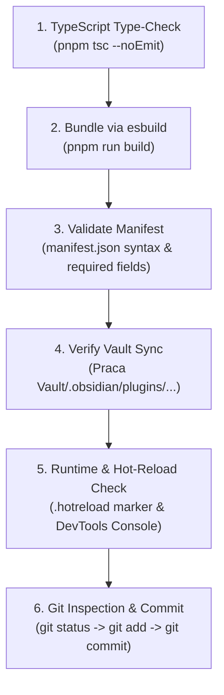

# AGENTS.md / AGENTS.md

## Project Overview
**Obsidian Plugin Builder** is a unified engineering environment, knowledge base, and scaffolding system for designing, building, testing, refactoring, and deploying custom plugins for the **Obsidian** ecosystem.

The repository is tightly integrated with the user's primary vault **`Praca Vault`** (`G:\Mój dysk\Obsidian Vaults\Praca Vault\`) and linked with the user's custom plugin library (`G:\Mój dysk\Obsidian\` – including `CalendarSyncPro`, `Orders`, `Timekeep`, `Gantt`, and projects in `G:\Mój dysk\Projekty Antigravity\`).

### Core Architectural Principles
1. **Environment Separation**: Develop in clean, modular TypeScript source code within a dedicated dev environment.
2. **Fast Bundling**: Bundle into a single CommonJS executable (`main.js`) using `esbuild`.
3. **Auto-Sync & Hot-Reload**: Automatically deploy compiled artifacts (`main.js`, `manifest.json`, and optionally `styles.css` + `.hotreload` marker) directly to the production vault directory: `G:\Mój dysk\Obsidian Vaults\Praca Vault\.obsidian\plugins\<plugin-id>\`.
4. **Strict Git Versioning**: Maintain a clean Git repository with atomic commits after each completed prompt and engineering milestone.
5. **Language Policy**: Although this instruction file is in English for token efficiency, **always communicate with the user in Polish** (unless explicitly asked otherwise).

---

## Tech Stack
- **Runtime & Shell**:
  - **Node.js**: v24.x LTS (matching `node -v`).
  - **OS & Shell**: Windows 11, PowerShell (always wrap paths containing spaces or Polish diacritics in double quotes `"`).
  - **Windows MAX_PATH & Git Long Paths**: In deep Obsidian Vault note hierarchies, Windows Git requires `git config core.longpaths true` to prevent `Filename too long` errors during staging, checkout, or commit.
- **Language & Compiler**:
  - **TypeScript**: v5.4+ / v6.x (`strict: true`, `strictNullChecks: true`, `noImplicitAny: true`, target `ES2022`, module `ESNext`, moduleResolution `bundler`).
- **Package Manager**:
  - **pnpm**: v10.x+ (default and preferred for performance and deduplication; keep global `store-dir` on local `C:\` drive to avoid Google Drive sync locks) or `npm` as fallback.
- **Bundler & Build Automation**:
  - **esbuild**: Configured via `esbuild.config.mjs` (target `es2022`, format `cjs`, platform `node`, external: `["obsidian", "electron", "@codemirror/*", ...builtinModules]`). Includes a `copyToVault` plugin on `build.onEnd` that copies build artifacts to `Praca Vault` and touches `.hotreload` in dev mode.
  - **Optional Advanced Tooling** (for complex plugins with extensive test suites, like `Timekeep`): `vite` + `vitest` + `oxlint` + `oxfmt`.
- **Libraries & UI**:
  - **Obsidian API**: `obsidian` (`latest` / `^1.7.0`+), `tslib` (`^2.6.3`).
  - **Lightweight UI**: Vanilla Obsidian DOM (`createEl`, `Setting`, `Modal`, `ItemView`) + native Obsidian icons (`setIcon`).
  - **Complex Views & Dashboards** (calendars, timelines, charts): Preact / React + Lucide icons (`lucide-preact` / `lucide-react`) + Zustand (following the `Gantt` architecture).
- **Data Formats & External Integrations**:
  - **JSON**: `manifest.json` (plugin metadata), `versions.json` (compatibility map), `data.json` (plugin state/settings managed via `loadData()` / `saveData()`).
  - **Markdown & Structured Data**: Obsidian Flavored Markdown (OFM), YAML Frontmatter, Obsidian Bases (`.base`), JSON Canvas (`.canvas`).
  - **Integrations**: Excel spreadsheets (`xlsx`), CalDAV / Microsoft Graph API, Windows Task Scheduler (`Register-ScheduledTask`).

---

## Commands

### 1. Initialization & Packages
```powershell
# Install project dependencies
pnpm install

# Add core dev dependencies
pnpm add -D obsidian typescript esbuild @types/node tslib
```

### 2. Type-Checking & Build
```powershell
# Static TypeScript verification (no output files)
pnpm tsc --noEmit
# Fallback via direct node execution:
& node ./node_modules/typescript/bin/tsc -noEmit -skipLibCheck

# Development mode (watch mode + auto-sync to Praca Vault + .hotreload)
pnpm run dev
# (runs: node esbuild.config.mjs)

# Production build (minified + synced to Praca Vault)
pnpm run build
# (runs: node esbuild.config.mjs production or build.ps1)
```

### 3. Code Quality, Linting & Testing
```powershell
# Fast linter (oxlint or eslint)
npx oxlint
# or: pnpm run lint

# Format check & auto-fix (oxfmt or prettier)
npx oxfmt --check
npx oxfmt --fix
# or: pnpm run fmt

# Run unit tests
pnpm test
# (npx vitest run / npx jest)
```

### 4. Versioning & Release
```powershell
# Bump version in manifest.json and versions.json
node scripts/version-bump.mjs
```

### 5. Git Version Control
```powershell
# Inspect modified and untracked files
git status --short

# Inspect code diffs
git diff --stat

# Stage verified files and create an atomic commit
git add src/ manifest.json package.json tsconfig.json esbuild.config.mjs styles.css AGENTS.md
git commit -m "type(scope): concise description of completed step"
```

---

## Conventions

### 1. Standard Directory Structure
```text
<plugin-name>/
├── .github/workflows/       # (Optional) CI/CD for automated GitHub Releases
├── scripts/                 # Helper scripts (version-bump.mjs, build.ps1, sync tools)
├── src/
│   ├── main.ts              # Entry point: plugin class extending 'Plugin'
│   ├── settings.ts          # PluginSettings interface, DEFAULT_SETTINGS, PluginSettingTab
│   ├── types.ts             # Shared TypeScript interfaces, event signatures, contracts
│   ├── views/               # ItemView implementations (sidebars, custom leaves)
│   ├── modals/              # Modal windows (Modal, ConfirmDialog, SuggestModal)
│   ├── services/            # Business logic (sync, parsers, external API integrations)
│   └── utils/               # Helpers (formatting, validation, safe DOM utilities)
├── tests/                   # Unit tests (*.test.ts)
├── esbuild.config.mjs       # esbuild config with automatic copyToVault plugin
├── manifest.json            # Obsidian plugin metadata (id, name, version, minAppVersion, isDesktopOnly)
├── package.json             # Node.js package definition, dependencies, and scripts
├── styles.css               # Scoped plugin stylesheet
├── tsconfig.json            # TypeScript compiler configuration
├── versions.json            # Plugin version to minAppVersion mapping
├── .gitignore               # Git exclusions (node_modules/, dist/, data.json, .env, .gemini/)
└── AGENTS.md                # Operational instructions and architecture rules
```

### 2. Naming & Styling Conventions
- **TypeScript Source Files**: `camelCase.ts` (e.g., `main.ts`, `settings.ts`, `types.ts`, `orderSync.ts`, `templateManager.ts`, `scheduler.ts`).
- **Classes & Components**: `PascalCase` (e.g., `CalendarSyncPlugin`, `OrdersSettingTab`, `GanttCalendarView`).
- **Interfaces & Types**: `PascalCase` without `I` prefix (e.g., `PluginSettings`, `TaskRecord`, `SyncResult`).
- **Methods & Variables**: `camelCase` (e.g., `loadSettings`, `saveSettings`, `refreshTasks`).
- **CSS Selectors & Theme Variables**:
  - Prefix **every** CSS class with the unique plugin identifier (e.g., `.calendar-sync-view`, `.obsidian-orders-modal`, `.timekeep-badge`) to prevent collisions with Obsidian themes and other plugins.
  - Never style bare global tags (`div`, `p`, `span`, `input`) without a plugin scope class.
  - Always prefer native Obsidian CSS variables (e.g., `var(--background-primary)`, `var(--background-secondary)`, `var(--text-normal)`, `var(--text-muted)`, `var(--interactive-accent)`) over hardcoded HEX/RGB colors for automatic light/dark mode support.
- **Encoding**: Save all `.ts`, `.json`, `.css`, and `.md` files in clean **UTF-8 without BOM**, preserving full support for Polish diacritics.

### 3. `Praca Vault` Integration Convention
- Target path constant in `esbuild.config.mjs`:
  ```javascript
  const vaultPluginDir = "g:/Mój dysk/Obsidian Vaults/Praca Vault/.obsidian/plugins/<plugin-id>";
  ```
- On every successful build, `copyToVault()` ensures the target directory exists, copies `manifest.json`, `main.js`, and `styles.css` (if present), and creates an empty `.hotreload` file during `dev` mode.

---

## Critical Rules

### 1. Vault & Obsidian Configuration Protection
- **Strict Plugin Isolation**: File operations inside `G:\Mój dysk\Obsidian Vaults\Praca Vault\.obsidian\plugins\` must **only** target the directory of the currently developed plugin.
- **Never Modify Global Vault Configs**: Never edit or delete global `.obsidian/` files (`app.json`, `community-plugins.json`, `workspace.json`, Pandoc GUI profiles, etc.).
- **Safe Note & Frontmatter Manipulation**:
  - For background note content updates, always use `app.vault.process(file, (data) => ...)` (for active editor changes, prefer `editor.replaceRange` / `editor.replaceSelection`).
  - For reading or modifying YAML Frontmatter, **always** use `app.fileManager.processFrontMatter(file, (frontmatter) => ...)`. Never parse or overwrite `---` YAML blocks manually with regex.

### 2. Google Drive I/O Lock Mitigation
- **Path Formatting**: Always use forward slashes `/` in JS/Node.js (`g:/Mój dysk/...`) and double-quoted backslashes in PowerShell (`"G:\Mój dysk\..."`).
- **Local Build Buffering**: If Google Drive sync locks `node_modules` during compilation (`EBUSY` / `EPERM`), use the `build.ps1` pattern: compile inside a local buffer (`$env:USERPROFILE\.gemini\builds\<plugin-id>`) and copy the resulting `main.js` and `manifest.json` back to the project and vault.

### 3. Obsidian Lifecycle & Memory Management
- **Safe Registration**: Register all workspace/vault events (`this.registerEvent(...)`), DOM listeners (`this.registerDomEvent(...)`), intervals (`this.registerInterval(...)`), commands (`this.addCommand(...)`), and views (`this.registerView(...)`) inside `onload()`.
- **Clean Resource Disposal (`onunload` vs `ItemView.onClose`)**:
  - **NEVER call `this.app.workspace.detachLeavesOfType(...)` inside `onunload()`**: Detaching leaves on unload resets the user's workspace layout when the plugin updates or reloads.
  - Unmount UI component trees (e.g., Preact/React `root.unmount()`) and clean up view-specific listeners inside `async onClose()` of the `ItemView` subclass.
  - Use `onunload()` only to tear down global resources not managed by `this.register*` (e.g., WebSockets, external IPC servers, background workers).
- **Platform Agnosticism**: Do not import Node.js builtins (`fs`, `child_process`, `path`, `crypto`) unless `"isDesktopOnly": true` is explicitly set in `manifest.json`.
- **Metadata Access**: Always query note metadata and links via `this.app.metadataCache` instead of reading and parsing files from disk in loops.

### 4. Security, Secrets & Destructive Command Protection (Stop & Verify)
- **Secret Protection**: Never hardcode API keys, CalDAV passwords, or Microsoft Graph tokens in `src/`, `DEFAULT_SETTINGS`, or Git commits. Store credentials exclusively in local vault `data.json` (git-ignored) or Obsidian's local storage (`app.loadLocalStorage` / `app.saveLocalStorage`).
- **No Destructive Commands**: Never run `git reset --hard`, `git clean -fd`, `Remove-Item -Recurse -Force`, or `rmdir /s /q` without explicit user authorization.
- **Metadata Integrity**: Never delete or manually corrupt `.git` or `.meta` structures.

### 5. UI, Modals & Code Block Error Recovery
- **Spacious & Accessible Modals**:
  - Rozbudowane kreatory konfiguracji, selektory plików i podglądy tabel w Obsidianie muszą posiadać wyraźnie zdefiniowane wymiary minimalne (np. `min-width: 800px`, `min-height: 600px`, `max-height: 85vh`).
  - Rozwijane listy i wyniki wyszukiwania muszą być osadzane w naturalnym przepływie flexbox/grid z pionowym paskiem przewijania (`overflow-y: auto`), a nie jako nakładki `position: absolute`, które zasłaniają dolne przyciski zatwierdzające formularza.
- **Floating Modals vs Inline Table Mutations**:
  - **Nigdy nie implementuj edycji rekordów inline wewnątrz istniejących tabel** (np. zamiana wiersza `<tr>` na formularz z inputami). Zmiany inline deformują strukturę tabeli, a reaktywne przeładowanie widoku lub odświeżanie w tle niszczy aktywny wiersz edycyjny, powodując zniknięcie formularza po ułamku sekundy.
  - Zawsze otwieraj dedykowane pływające okno modalne (`EditEntryModal` rozszerzające `Modal` Obsidiana) z odrębnym, izolowanym cyklem życia.
- **Natural / Alphanumeric Sorting**:
  - Dla wszelkich list użytkownika zawierających identyfikatory liczbowe, części, kroki lub etapy (np. `Part 1`, `Part 2`, `Part 10`) **bezwzględnie stosuj sortowanie naturalne**:
    ```typescript
    items.sort((a, b) => a.name.localeCompare(b.name, undefined, { numeric: true, sensitivity: 'base' }));
    ```
  - Nigdy nie używaj domyślnego sortowania leksykalnego ASCII, które umieszcza `Part 10` przed `Part 2`.
- **MRU (Most Recently Used) Sorting w Autouzupełnianiu**:
  - Kontrolki `SuggestModal`, pola wyboru projektów, tagów, kategorii oraz typów działań w blokach konfiguracji i modalach **muszą domyślnie sortować opcje według ostatniego użycia (MRU)**, a nie czysto alfabetycznie. Najczęściej i ostatnio wybierane elementy muszą znajdować się na szczycie listy rozwijanej.
- **Context Menu & Viewport Clamping**:
  - Niestandardowe menu kontekstowe muszą weryfikować pozycję względem krawędzi okna (`window.innerWidth`, `window.innerHeight`) i odwracać lub korygować współrzędne, aby menu nigdy nie wychodziło poza widoczny obszar ekranu.
  - Zdarzenia `pointerdown` i `mousedown` na elementach przeciągalnych (paski zadań, uchwyty zmiany rozmiaru) muszą weryfikować przycisk myszy (`e.button === 0`). Kliknięcie prawym przyciskiem (`e.button === 2`) **nie może** inicjować przeciągania, aby nie blokować natywnego zdarzenia `contextmenu`.
  - W handlerach `contextmenu` zawsze stosuj `e.preventDefault()` oraz `e.stopPropagation()`.
- **Selection State Persistence**:
  - Reaktywne kontrolki `select` lub listy wyboru przy dynamicznym przeładowywaniu danych źródłowych muszą zachowywać poprzednio wybraną wartość, jeśli nadal istnieje ona na liście, zamiast bezwarunkowo resetować się do pierwszego indeksu.
- **Code Block Processor Error Resilience**:
  - W procesorach bloków kodu (`MarkdownRenderChild`) błąd parsowania lub odczytu zasobów nie może ukrywać paska akcji. Przycisk edycji bloku musi być zawsze dostępny, aby użytkownik mógł poprawić błędne parametry w oknie modalnym.
- **Windows CRLF-Safe Vault Processing**:
  - Przy aktualizacji notatek w `app.vault.process(file, (data) => ...)` uwzględniaj specyfikę Windows (`\r\n`). Zawsze dziel linie za pomocą regexa `data.split(/\r?\n/)`, wykrywaj format (`const isCrlf = data.includes('\r\n')`) i scalaj za pomocą `lines.join(isCrlf ? '\r\n' : '\n')`.
- **Plugin Metadata & In-App Documentation Tab**:
  - W pliku `manifest.json` autorem wtyczki musi być **Piotr Świerk** (`"author": "Piotr Świerk"`).
  - W zakładce ustawień wtyczki (`PluginSettingTab`) zawsze dodawaj sekcję lub dedykowaną podzakładkę **„Jak używać”**, zawierającą zwięzłą dokumentację bloków kodu, dostępnych komend i parametrów w języku polskim.

### 6. Git Standards & Commit Procedure
- **Mandatory Commit After Each Logical Step**:
  1. Check modified files via `git status --short` and `git diff --stat`.
  2. Verify compilation (`pnpm tsc --noEmit` and `pnpm run build`).
  3. Stage only verified project files (avoid blind `git add -A` if `.env`, `data.json`, or temporary logs are present) and create an atomic commit.
- **Conventional Commits Format**:
  - `feat(<scope>): <new feature description>`
  - `fix(<scope>): <bug fix description>`
  - `refactor(<scope>): <code restructuring>`
  - `docs(<scope>): <documentation / AGENTS.md updates>`
  - `chore(<scope>): <dependencies / build config>`
- **No Force Push**: Never run `git push --force`.

---

## Validation Procedure
Before finishing any task or committing code, execute this 6-step verification checklist:



1. **Static TypeScript Check**:
   Run `pnpm tsc --noEmit`. Must exit with code `0` and zero type errors.
2. **esbuild Bundling**:
   Run `pnpm run build` (or `node esbuild.config.mjs production`). Confirm `main.js` is generated without unresolved external warnings.
3. **Manifest Validation (`manifest.json`)**:
   Verify valid JSON syntax and required fields: `id`, `name`, `version`, `minAppVersion`.
4. **Vault Sync Verification (`Praca Vault`)**:
   Confirm up-to-date `main.js`, `manifest.json`, and `styles.css` exist in `G:\Mój dysk\Obsidian Vaults\Praca Vault\.obsidian\plugins\<plugin-id>\`.
5. **Obsidian Runtime Verification**:
   - *Agent*: Ensure `.hotreload` is touched in the vault plugin folder (or build completed cleanly).
   - *User / DevTools*: Reload the plugin in Obsidian and verify via DevTools Console (`Ctrl + Shift + I`) that no runtime exceptions or unregistered event warnings occur.
6. **Git Commit**:
   Inspect `git status --short` and `git diff --stat`, stage relevant files, and commit using Conventional Commits.